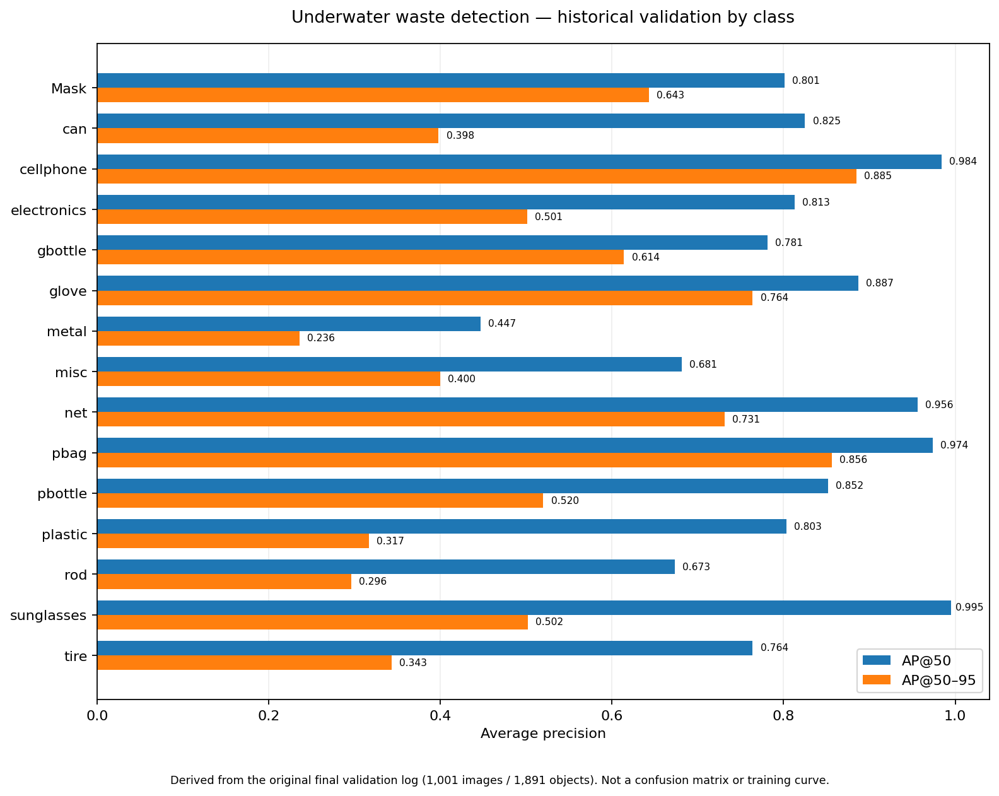
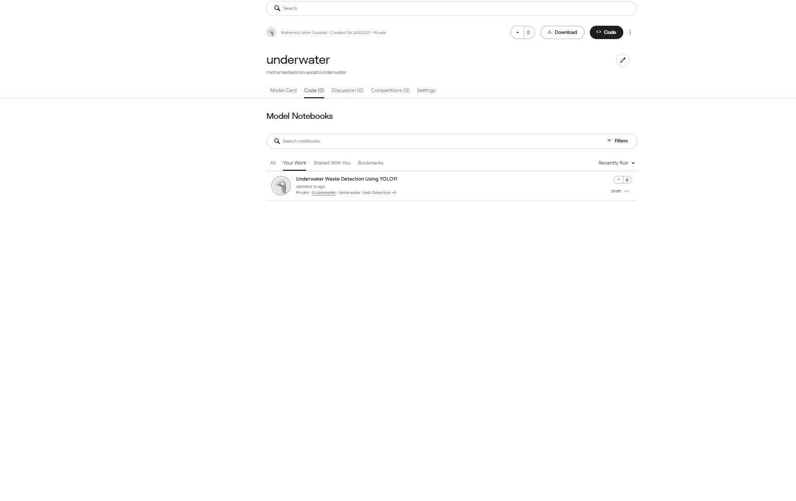

# Underwater Waste Detection with YOLO11l

**Python · Ultralytics YOLO11l · Fine-tuning · 15-class object detection · Kaggle**

A multi-class underwater-debris detection project originally developed in a private Kaggle notebook in 2025. This repository is a cleaned and documented portfolio presentation assembled in November 2026. The original Kaggle notebook is preserved privately; its dated history and outputs can be made available for verification on request.

The original experiment **fine-tuned an existing object-detection checkpoint** for 100 epochs. It did not train a detector from scratch.

## Historical validation results

| Metric            | Recorded result |
| ----------------- | --------------: |
| Validation images |       **1,001** |
| Annotated objects |       **1,891** |
| Overall precision |       **0.850** |
| Overall recall    |       **0.750** |
| Overall mAP@50    |       **0.816** |
| Overall mAP@50–95 |       **0.534** |

**Source:** the original completed YOLO validation log in [`evidence/original_training_excerpt.txt`](evidence/original_training_excerpt.txt). These metrics are from the historical validation split, **not an independent test dataset**, and they have not been reproduced by this cleaned repository.

### Per-class results

The chart below was **created from the recorded validation table**; it is **not** a saved training-curve figure or a confusion matrix.



| Class         | Objects | Precision | Recall | AP@50 | AP@50–95 |
| ------------- | ------: | --------: | -----: | ----: | -------: |
| `Mask`        |      90 |     0.976 |  0.460 | 0.801 |    0.643 |
| `can`         |      20 |     0.829 |  0.750 | 0.825 |    0.398 |
| `cellphone`   |      71 |     0.988 |  0.972 | 0.984 |    0.885 |
| `electronics` |      40 |     0.898 |  0.725 | 0.813 |    0.501 |
| `gbottle`     |      82 |     0.760 |  0.734 | 0.781 |    0.614 |
| `glove`       |      55 |     0.897 |  0.800 | 0.887 |    0.764 |
| `metal`       |      22 |     0.597 |  0.409 | 0.447 |    0.236 |
| `misc`        |      51 |     0.625 |  0.786 | 0.681 |    0.400 |
| `net`         |     148 |     0.951 |  0.909 | 0.956 |    0.731 |
| `pbag`        |     330 |     0.910 |  0.985 | 0.974 |    0.856 |
| `pbottle`     |     284 |     0.860 |  0.796 | 0.852 |    0.520 |
| `plastic`     |      59 |     0.825 |  0.719 | 0.803 |    0.317 |
| `rod`         |       9 |     0.911 |  0.556 | 0.673 |    0.296 |
| `sunglasses`  |       3 |     0.880 |  1.000 | 0.995 |    0.502 |
| `tire`        |     627 |     0.837 |  0.644 | 0.764 |    0.343 |

The complete machine-readable table is in [`evidence/historical_validation_per_class.csv`](evidence/historical_validation_per_class.csv).

**Interpretation:** `cellphone` (0.984 AP@50), `pbag` (0.974), and `net` (0.956) performed well on the original validation split. `metal` (0.447), `rod` (0.673), and `misc` (0.681) were more difficult. A high AP value on a tiny class is not strong evidence of robustness: `sunglasses` has only **3** validation instances and `rod` has **9**. `tire` has 627 instances but only 0.343 AP@50–95, indicating weaker precise localization than its AP@50 suggests. Per-class precision and recall depend on the original evaluation settings.

**Not available in the preserved files:** the original per-epoch `results.png` training curves and a class-by-class confusion matrix. A summary of precision, recall and AP values **cannot be converted into a confusion matrix**. Neither missing figure is required to understand the reported evaluation.

## Model inference examples — November 2026

I loaded the archived Kaggle model `mohamedselimoueslati/underwater` and ran inference on underwater images in November 2026. The examples included detections labelled `pbag`, `pbottle`, and `glove`. These are **illustrative predictions, not an independent performance assessment**.

Some test photographs contain third-party stock-photo watermarks. Their annotated versions have deliberately **not been placed in this public repository**.

## How to reproduce

### Run inference without retraining

1. Open [`saved_model_inference.ipynb`](saved_model_inference.ipynb) on Kaggle.
2. Attach the model `mohamedselimoueslati/underwater` and the original underwater image dataset as Kaggle inputs.
3. Check the checkpoint path printed by the notebook and verify which training run produced it.
4. Run the notebook to create annotated predictions and `underwater_predictions.zip`.

Inference outputs are written to `/kaggle/working/underwater_predictions/`. The notebook also searches for images under nested Kaggle input directories.

### Historical training configuration

| Setting                              | Recorded value                                                                       |
| ------------------------------------ | ------------------------------------------------------------------------------------ |
| Detector                             | YOLO11l                                                                              |
| Fine-tuning                          | 100 epochs                                                                           |
| Image size                           | 640                                                                                  |
| Accelerator                          | Tesla P100                                                                           |
| Ultralytics version                  | 8.3.237                                                                              |
| Original dataset YAML                | `/kaggle/input/underwater-plastic-pollution-detection/underwater_plastics/data.yaml` |
| Original _starting_ weights          | `/kaggle/input/underwater/other/default/1/best.pt`                                   |
| Completed run's _final_ best weights | `/kaggle/working/runs/detect/train/weights/best.pt`                                  |

[`train_and_validate.ipynb`](train_and_validate.ipynb) contains a cleaned reconstruction of the historical training and validation workflow. It has been checked for notebook structure and Python syntax, **not rerun**. Keep `RUN_TRAINING=False` unless intentionally training a new model.

## Limitations

- Validation performance on the original dataset does not establish accuracy on unfamiliar underwater environments or cameras.
- Rare classes have very small validation sample sizes, especially `sunglasses`, `rod`, and `metal`.
- Some qualitative inference images show potential category mistakes; model confidence is not ground-truth correctness.
- The original notebook includes an incomplete SAM2 attempt, but **no successful segmentation experiment is claimed here**.
- A later exploratory evaluation cell used the training split despite being described as a test. **No independent test results are claimed.**

## Datasets and attribution

### Dataset used for the reported training and validation

**[Underwater Plastic Pollution Detection](https://www.kaggle.com/datasets/arnavs19/underwater-plastic-pollution-detection)** — Kaggle listing under `arnavs19`. The original notebook explicitly fine-tuned the checkpoint using:

```text
/kaggle/input/underwater-plastic-pollution-detection/underwater_plastics/data.yaml
```

This dataset has 15 object classes and is reported as containing 3,628 training images, 1,001 validation images and 501 test images. The reported metrics in this repository are from the 1,001-image **validation** split. An independent [dataset analysis](https://github.com/mchianale/Plastic-Pollution-Detection) describes the collection as derived from an Ocean Waste dataset on Roboflow, but the precise upstream Roboflow project/version and underlying photographic rights have not been independently verified.

**Attribution:** dataset distributed on Kaggle under the listing _Underwater Plastic Pollution Detection_ (`arnavs19`). The Kaggle dataset's exact license and upstream photo permissions should be checked at the source before reusing or redistributing the images. **No dataset photos, annotations or model weights are redistributed in this repository.**

### Other Kaggle inputs present in the original research notebook

These entries appeared as Kaggle inputs or in exploratory cells. **They were not used by the successful 100-epoch command whose validation results are reported above.**

| Input name                           | Source / role in the original notebook                                                                                                                                                                                                                                                                                                                                                                                  |
| ------------------------------------ | ----------------------------------------------------------------------------------------------------------------------------------------------------------------------------------------------------------------------------------------------------------------------------------------------------------------------------------------------------------------------------------------------------------------------- |
| **RealOcean Garbage** (`FinalOcean`) | [RealOcean Garbage — Aman Kamath, Kaggle](https://www.kaggle.com/datasets/amankamath/realocean-garbage). A later cell references `FinalOcean/OceanGarbage/Images` when exploring a different training setup. The dataset listing shows an MIT license, but verify the image-level reuse rights separately. No completed result from this branch is claimed.                                                             |
| **Underwater Trash Detection**       | [Underwater Trash Detection — Kaggle listing by `shivamb`](https://www.kaggle.com/datasets/shivamb/underwater-trash-detection), a copy of the [Trash-ICRA19 dataset](https://doi.org/10.13020/x0qn-y082) created by Michael S. Fulton, Jungseok Hong and Junaed Sattar, with imagery originally sourced from J-EDI/JAMSTEC. It was among the attached Kaggle inputs; the documented completed run does not train on it. |
| **The YAML / `the-yaml`**            | Auxiliary `data.yaml` referenced in an unfinished or unverified training attempt. Its uploader, configuration contents, and relationship to the datasets cannot be established from the preserved notebook alone.                                                                                                                                                                                                       |
| **`thedata` / “yamles”**             | Other YAML/configuration inputs associated with separate exploratory training commands.                                                                                                                                                                                                                                                                                                                                 |

The auxiliary YAML files **define dataset paths and class mappings**.

### Model, code and project history

The historical command started from `/kaggle/input/underwater/other/default/1/best.pt` and ran 100 epochs. The original logs establish the recorded training and validation metrics. A saved Kaggle model is available at `mohamedselimoueslati/underwater`.
Ultralytics YOLO is a third-party dependency with its own licensing terms; this repository does not redistribute Ultralytics source code or trained weights. This project is a cleaned **2026 documentation of earlier 2025 experiments**, not a claim of training anew in 2026.

The original private Kaggle notebook and saved history are available for verification by request at **selimoueslati0@gmail.com**. The exact notebook version dates must be confirmed in Kaggle before citing a specific training date.

**Project evidence:**

- [`evidence/original_training_excerpt.txt`](evidence/original_training_excerpt.txt) — preserved final run summary and validation table
- [`evidence/historical_validation_per_class.csv`](evidence/historical_validation_per_class.csv) — values used to generate the per-class chart
- [`assets/per_class_validation.png`](assets/per_class_validation.png) — visualization derived from that historical table in November 2026
- [`assets/kaggle_model_created.png`](assets/kaggle_model_created.png) — historical **model listing**, not proof of which checkpoint was saved

### Saved model listing — historical evidence



The screenshot shows the Kaggle **model** `mohamedselimoueslati/underwater`, with a displayed creation date of December 11, 2025.
